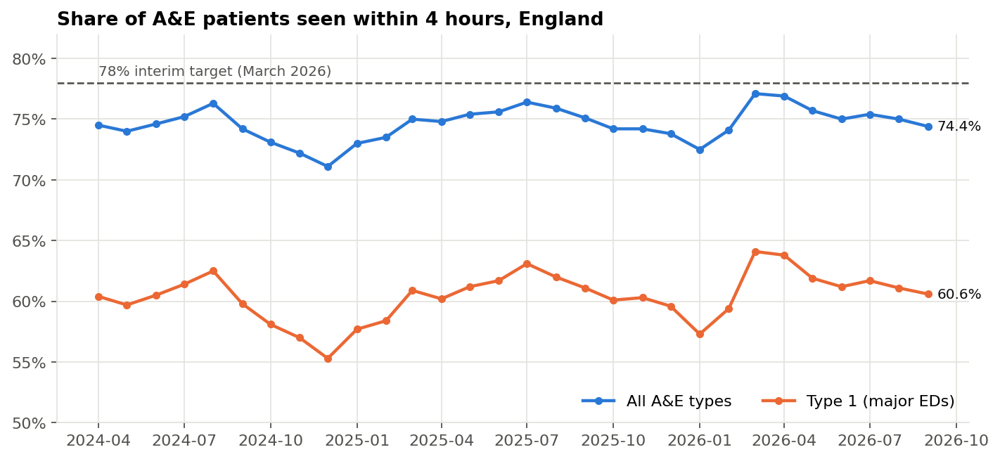

# NHS A&E Waiting Times: Where Does the Pressure Build Up?

An analysis of NHS England's published A&E data (April 2024 – September 2026), written from a business analyst's point of view: frame the problem, check the data, find where performance breaks down, and recommend what to look at first.

> **Real public data.** All figures come from NHS England's monthly A&E Attendances and Emergency Admissions statistics. The analysis and recommendations are my own and are not NHS guidance.

**Case study on my website:** a shorter write-up of this project is at [vinayakkoranga.com](https://vinayakkoranga.com/case-studies/nhs-ae-waiting-times/).

## The business question

The NHS constitutional standard is for 95% of A&E patients to be admitted, transferred or discharged within 4 hours. The interim target for March 2026 was 78%. Nationally, performance has stayed in the low-to-mid 70s.

This project asks:

1. How has 4-hour performance changed month by month, and how seasonal is it?
2. Which regions and trusts are furthest from the target, and is the gap getting smaller?
3. Is poor 4-hour performance linked to long waits for a bed after the decision to admit ("trolley waits")? In other words, is the bottleneck inside A&E or in flow out of A&E into the hospital?

## Status

| Stage | Status |
|---|---|
| Data sourced, loaded and reconciled | Done |
| [Data dictionary](docs/data-dictionary.md) | Done |
| [SQL analysis queries](sql/) and [results](outputs/sql_results.md) | Done |
| [Python analysis and charts](notebooks/analysis.ipynb) | Done |
| [Interactive dashboard](https://vinayak-koranga-analyst.github.io/nhs-ae-waiting-times-analysis/dashboard/) ([source](dashboard/index.html)) | Done |
| [Findings and recommendations](docs/findings-and-recommendations.md) | Done |

## Key findings



1. **The 78% target was narrowly missed.** Performance peaked at 77.1% in March 2026, then fell back to 74.4% by September 2026.
2. **Bed pressure is no longer just a winter problem.** 12-hour trolley waits in summer 2026 were 29% higher than in summer 2025.
3. **No region reached 78%.** The South West was the only region to get worse year on year.
4. **Trolley waits explain only part of the gap between trusts** (r = −0.26). Trusts with similar bed pressure range from 38% to 76% on the Type 1 4-hour measure, so department processes matter as much as beds.

Recommendations: [docs/findings-and-recommendations.md](docs/findings-and-recommendations.md).

**[Open the live dashboard](https://vinayak-koranga-analyst.github.io/nhs-ae-waiting-times-analysis/dashboard/)**

**Read the write-up:** [What 30 months of NHS A&E data says about the 4-hour target](https://vinayakkoranga.com/nhs-ae-4-hour-target-data/) (blog post on vinayakkoranga.com)

## Data

- **Source:** [NHS England, A&E Attendances and Emergency Admissions](https://www.england.nhs.uk/statistics/statistical-work-areas/ae-waiting-times-and-activity/), monthly provider-level CSVs. The URLs used are in [`data/sources.txt`](data/sources.txt).
- **Coverage:** 30 months (April 2024 – September 2026), 207 organisations, 5,905 organisation-month rows.
- **Licence:** contains public sector information licensed under the [Open Government Licence v3.0](https://www.nationalarchives.gov.uk/doc/open-government-licence/version/3/).

## How to run it

```bash
python3 -m venv .venv
source .venv/bin/activate
pip install -r requirements.txt
python src/load_data.py
python src/run_queries.py
python src/build_dashboard.py
jupyter notebook notebooks/analysis.ipynb
```

The dashboard is a single HTML file, published with GitHub Pages at [vinayak-koranga-analyst.github.io/nhs-ae-waiting-times-analysis/dashboard/](https://vinayak-koranga-analyst.github.io/nhs-ae-waiting-times-analysis/dashboard/).

The loader reads the 30 CSVs in `data/raw/`, standardises the column names, checks that each file's organisation rows add up to its published national total, and writes a DuckDB database (`data/ae.duckdb`) for the SQL queries.

## Repository layout

```text
dashboard/           Interactive dashboard (single HTML file)
data/raw/            Monthly CSVs as published by NHS England
data/sources.txt     Download URLs
docs/                Data dictionary, findings and recommendations
notebooks/           Analysis notebook with charts
outputs/             Query results (CSV, readable summary) and charts
sql/                 Analysis queries (DuckDB SQL)
src/load_data.py     Load, clean and reconcile the data
src/run_queries.py   Run all queries and write results to outputs/
src/build_dashboard.py  Build the dashboard from the query results
```

## Tools

SQL (DuckDB), Python (pandas, matplotlib, Plotly), Jupyter, Markdown.
