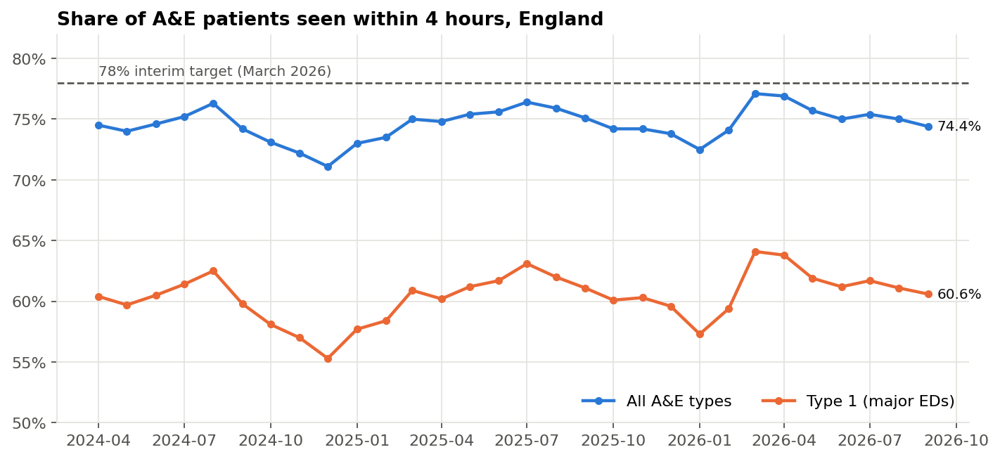
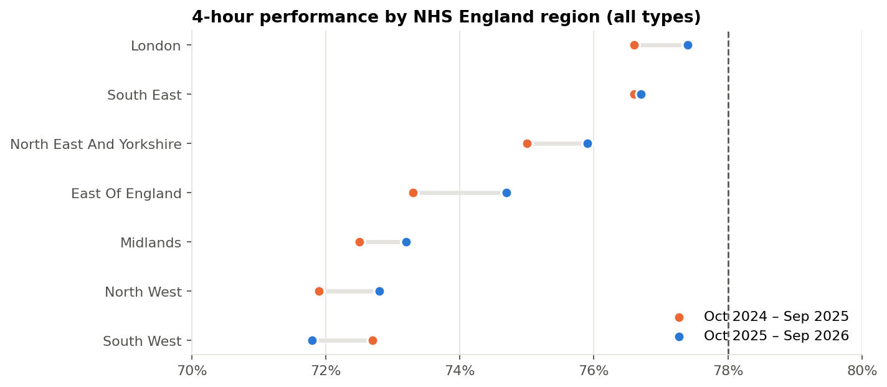
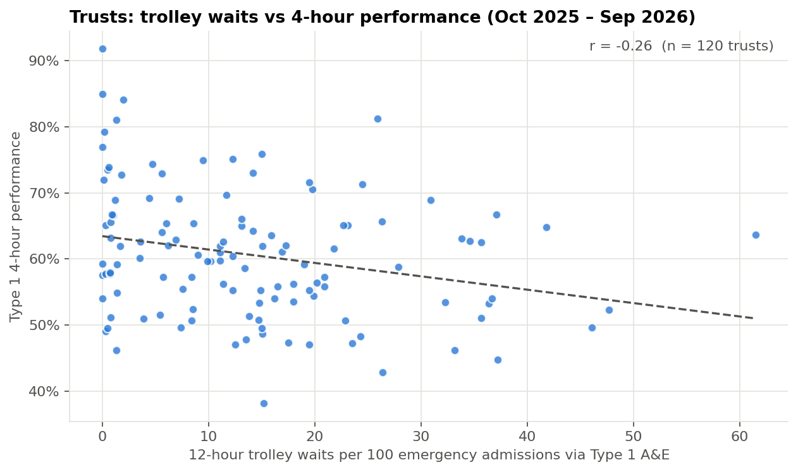

# A&E Waiting Times: Findings and Recommendations

**Data:** NHS England, A&E Attendances and Emergency Admissions, April 2024 – September 2026
**Author:** Vinayak Koranga. Independent analysis of public data; not NHS guidance.
**Supporting work:** [analysis notebook](../notebooks/analysis.ipynb), [SQL results](../outputs/sql_results.md), [live dashboard](https://vinayak-koranga-analyst.github.io/nhs-ae-waiting-times-analysis/dashboard/), [data dictionary](data-dictionary.md)

---

## Summary

England's A&E 4-hour performance has stayed between 71% and 77% for 30 months. It came closest to the 78% interim target in March 2026 (77.1%), then fell back to 74.4% by September 2026. Demand is still rising: attendances in the latest 12 months were about 4% higher than in April 2024 – March 2025.

Long waits for a bed after the decision to admit ("trolley waits") are part of the problem, but a smaller part than is often assumed. Trusts with the fewest trolley waits do perform better, but trolley waits explain only a small share of the difference between trusts. **The wide variation between trusts with similar bed pressures suggests that how each emergency department runs matters as much as the number of beds.**

## Findings

### 1. The target was narrowly missed, and the gain didn't hold

- March 2026: 77.1% (all A&E types), 0.9 points short of 78%.
- By September 2026 performance had dropped back to 74.4%, close to where it was in September 2025 (75.1%).
- Type 1 departments (major EDs) ran about 14 points below the all-types figure throughout. That's 60.6% in September 2026.

**What this means:** the March peak looks like a short-term push towards the target rather than a lasting improvement in how the system works.

### 2. Winter is worse, and summer pressure is rising

| Period | 4-hour (all types) | Average 12-hour trolley waits a month |
|---|---|---|
| Summer 2024 | 75.4% | 34,469 |
| Winter 2024/25 | 72.5% | 54,453 |
| Summer 2025 | 76.0% | 36,686 |
| Winter 2025/26 | 73.4% | 58,985 |
| Summer 2026 | 75.1% | 47,285 |

- Each winter, performance falls about 3 points and trolley waits rise by about 60%.
- **Summer 2026 trolley waits were 29% higher than summer 2025.** Hospitals went into autumn 2026 with less spare bed capacity than a year earlier.

### 3. No region reached the target; the South West went backwards

- Six of seven regions improved slightly year on year. London was best at 77.4%.
- The South West fell from 72.7% to 71.8% and has the lowest Type 1 performance (56.5%).
- The Midlands and North West combine low 4-hour performance with the highest trolley-wait rates (about 18 per 100 emergency admissions).

### 4. The gap between trusts is large

- 120 trusts reported Type 1 activity in every month of the latest 12. Their median Type 1 performance was 59.9%.
- 6 reached 78% or more; 17 were below 50%.

### 5. Trolley waits explain only part of the difference

| Trolley-wait quartile (12h waits per 100 admissions) | Type 1 4-hour performance |
|---|---|
| Q1 (0 – 3.5) | 65.4% |
| Q2 (3.6 – 12.3) | 61.8% |
| Q3 (12.3 – 19.8) | 58.2% |
| Q4 (19.9 – 61.5) | 58.8% |

- Trusts with the fewest trolley waits perform about 7 points better than those with the most.
- But the correlation across trusts is weak (r = −0.26), and there's no further drop between the third and fourth quartiles.
- Among the 40 trusts with 10–20 trolley waits per 100 admissions, Type 1 performance ranges from 38% to 76%.

## Recommendations

These are framed as next steps for an operational improvement team, such as an NHS England regional team or a trust's urgent care board.

| # | Recommendation | Why | How to measure |
|---|---|---|---|
| 1 | **Run peer-learning visits between "matched" trusts.** Pair trusts with similar trolley-wait rates but very different 4-hour performance (e.g. within the 10–20 per 100 band) and compare how their departments run. | Bed pressure alone doesn't explain the gap; the differences in department processes are where to look | Type 1 4-hour performance in the lower-performing trust of each pair, 6 months on |
| 2 | **Get arrival-to-decision times before designing fixes.** Use Emergency Care Data Set (ECDS) data to split each patient's wait into time to assessment, time to decision and time from decision to leaving A&E. | This dataset only shows the last stage. Without the earlier stages, we can't tell whether the delay is in A&E or after it | Share of over-4-hour waits explained by each stage, by trust |
| 3 | **Treat bed capacity as a year-round issue, not just a winter one.** Plan discharge and community capacity for summer as well as winter. | Summer 2026 trolley waits were 29% up on summer 2025 | Monthly 12-hour trolley waits in summer 2027 vs summer 2026 |
| 4 | **Prioritise the South West, Midlands and North West.** | Lowest performance; the South West is the only region getting worse | Regional 4-hour performance against 78% |
| 5 | **Check how trolley waits are recorded.** 20 trusts report fewer than 1 trolley wait per 100 admissions. 3 are children's trusts, where this is plausible; the rest should be checked before any trust-level comparison is used for decisions. | Inconsistent recording would distort comparisons like the ones above | Number of trusts with unexplained near-zero reporting |

## Limitations

- Monthly totals only: no patient-level waits, causes of delay or case mix.
- Trolley waits are measured from the decision to admit, not from arrival.
- Correlation isn't cause. Trusts with fewer trolley waits may differ in other ways, such as size, patient mix or the support available outside the hospital.
- Trust mergers mean the number of reporting organisations changes over time. Trust comparisons use only the 120 trusts with a full 12 months of Type 1 data.
